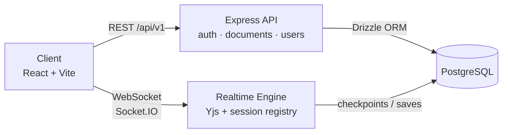
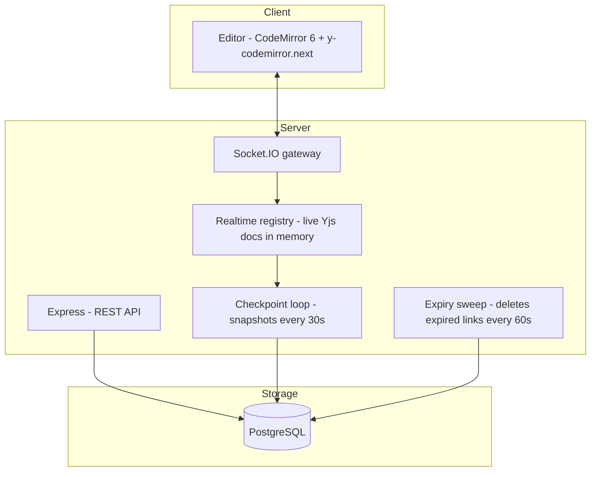
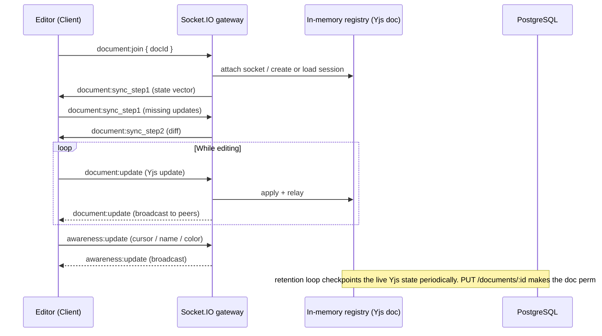

# TypeTogether

A real-time collaborative editor. Share a document link, start typing, and everyone sees the same text live. No login required to collaborate — accounts simply make saved documents permanent.

Backend-first project: REST API, authentication, and the real-time collaboration engine run on a single Node.js server.

## Architecture





## Tech Stack

| Layer | Tools |
| --- | --- |
| Backend | Node.js, Express 5, TypeScript |
| Real-time | Socket.IO, Yjs, y-protocols |
| Database | PostgreSQL + Drizzle ORM (SQL migrations) |
| Auth | bcryptjs, JWT in `httpOnly` cookie |
| Validation | Zod (env config + request payloads) |
| Frontend | React 19 + Vite, Tailwind CSS 4, CodeMirror 6, react-hot-toast |
| Testing | Vitest + Supertest (server) |

## Backend Design Decisions

- **Single port for REST and WebSockets** — Socket.IO shares the Express HTTP server, so one process and one port serve everything.
- **Cookie-based auth for both protocols** — the JWT lives in an `httpOnly` cookie; the Socket.IO handshake middleware reads it from the handshake cookie header. No apart tokens, no localStorage.
- **Guest-first model** — documents can be created without an account via a share link. Anonymous links expire after `LINK_RETENTION_HOURS` (24h default) unless saved by a logged-in user.
- **In-memory session registry** — live Yjs documents are held per-room; every socket update is relayed to other occupants and periodically checkpointed to Postgres by a background retention loop.
- **Expiry sweep** — a background loop removes documents whose reference count reached zero past retention, disconnecting any stragglers with a `document:error`.
- **Typed realtime contract** — client/server socket payloads share typed event declarations, so both sides compile against the same interface.
- **Env validation at boot** — `env.ts` is Zod-parsed on startup and the server refuses to run with missing/invalid config.

## Real-time Editing Flow



## REST API (`/api/v1`)

| Method | Endpoint | Auth | Purpose |
| --- | --- | --- | --- |
| `POST` | `/auth/signup` | — | Create account |
| `POST` | `/auth/login` | — | Log in (sets JWT cookie) |
| `POST` | `/auth/logout` | — | Clear cookie |
| `GET` | `/auth/me` | cookie | Current user |
| `POST` | `/documents` | — | Create document (returns share URL) |
| `GET` | `/documents/:id` | — | Fetch document snapshot |
| `PATCH` | `/documents/:id` | — | Rename document |
| `PUT` | `/documents/:id` | cookie | Save content + title (makes link permanent) |
| `DELETE` | `/documents/:id` | cookie | Delete document |
| `GET` | `/users/me/documents` | cookie | List my saved documents |

### Socket.IO events (namespace `/`)

| Event | Direction | Purpose |
| --- | --- | --- |
| `document:join` / ack | C → S | Join a document room, receive room metadata |
| `document:sync_step1/2` | both | Yjs state-vector sync handshake |
| `document:update` | C → S | Apply + relay doc updates to peers |
| `document:rename` | C → S | Renaming reconstructed live for all occupants |
| `awareness:update` | both | Cursor positions, names, colors |
| `document:error` | S → C | Expired / unknown document |
| `session:init` | S → C | Auth state as seen by the server |

## Project Structure

```
server/
├─ src/
│  ├─ config/          # validated env, cookie settings
│  ├─ routes/          # REST routers (auth, documents, users)
│  ├─ controllers/     # HTTP handlers
│  ├─ services/        # business logic
│  ├─ db/              # Drizzle client + schema
│  ├─ middleware/      # authGuard, error handler
│  ├─ realtime/        # socket gateway, session registry, checkpoint, expiry sweep
│  └─ utils/           # JWT, async handler, ApiError
├─ tests/              # Vitest + Supertest suites
└─ drizzle/            # SQL migrations
client/
├─ src/
│  ├─ components/      # Header, save-login modal, route guards
│  ├─ lib/             # REST client, auth context, Yjs socket provider, CodeMirror setup
│  └─ pages/           # Home, Dashboard, Editor, Login, Signup
```

## Running Locally

Prerequisites: Node.js 20+, PostgreSQL.

```bash
# 1. Server
cd server
npm install
cp .env.example .env        # fill DATABASE_URL, JWT_SECRET
npm run db:generate         # (already generated; only when schema.ts changes)
npm run db:migrate
npm run dev                 # http://localhost:3000

# 2. Client
cd ../client
npm install
npm run dev                 # http://localhost:5173 (Vite proxies /api and /socket.io)
```

### Environment Variables (server)

| Variable | Default | Purpose |
| --- | --- | --- |
| `DATABASE_URL` | — (**required**) | PostgreSQL connection string |
| `JWT_SECRET` | `dev-only-change-me` | Auth token signing (must change in production) |
| `PORT` | `3000` | HTTP + Socket.IO port |
| `CORS_ORIGIN` | `http://localhost:5173` | Allowed client origin |
| `LINK_RETENTION_HOURS` | `24` | Anonymous link lifetime before expiry |
| `RETENTION_CHECKPOINT_SECONDS` | `30` | Live-doc snapshot interval |
| `EXPIRY_SWEEP_SECONDS` | `60` | Expired-document sweep interval |

## Deployment

- **Backend → Render** (`server/` as root dir): build `npm install && npm run build`, start `node dist/server.js`, health check path `/health`. Env vars: `DATABASE_URL`, `JWT_SECRET`, `NODE_ENV=production`, `CORS_ORIGIN=https://<client>.vercel.app`. Run `npm run db:migrate` once against the production database. Cross-domain auth is handled server-side via `SameSite=None` cookies in production. Run a **single instance** — the live-document registry, expiry sweep and checkpoint loop are in-process.
- **Frontend → Vercel** (`client/` as root dir, Vite auto-detected): env vars `VITE_API_URL` and `VITE_SOCKET_URL`, both set to the Render origin. `vercel.json` rewrites all paths to `index.html` (SPA routing).

## Tests

```bash
cd server
npm test      # Vitest suites: auth, documents, realtime, reconnect, checkpoint, expiry, registry
```

Test coverage focuses on the backend: HTTP API behavior, token auth, socket join/sync flows, reconnect handling, retention checkpoints, and the expiry sweep.
